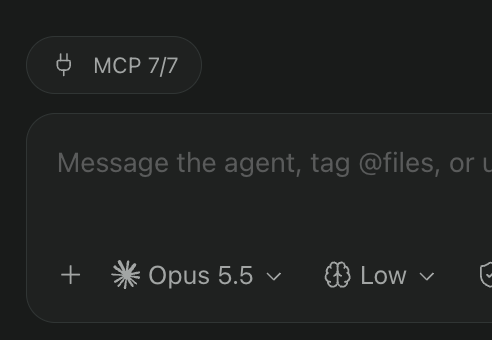

# MCP status

A [Paseo](https://github.com/getpaseo) plugin that shows the health of the MCP servers configured for each Claude Code or Codex agent, and lets you fix authentication and approval issues without leaving Paseo.



## Features

- **Composer pill** per agent showing connected vs. active servers, e.g. `MCP 3/4 ⚠`.
- **Status popover** listing every server with its target, state and detail, plus a manual refresh.
- **One-click OAuth login** for servers that need authentication (runs `<cli> mcp login <server>`, which opens the browser).
- **Project server approval** for Claude Code: approves pending `.mcp.json` servers by adding them to `enabledMcpjsonServers` in `<cwd>/.claude/settings.local.json`.
- **Timeline alerts** posted in the agent conversation when a server needs authentication, updated in place once it is resolved.

Server states: `connected`, `needs-auth`, `pending-approval`, `failed`, `disabled`.

## How it works

The server side listens to agent lifecycle hooks (`agent.created`, `agent.turn_started`, `agent.turn_ended`, `agent.closed`, `agent.archived`) and tracks agents per provider and working directory. Status is fetched by running the provider CLI in the agent's `cwd`:

| Provider    | Command                 |
| ----------- | ----------------------- |
| Claude Code | `claude mcp list`       |
| Codex       | `codex mcp list --json` |

Results are cached per `(provider, cwd)` and refreshed every 60 s for active agents. The client polls the cached status every 5 s to update pills.

CLI binaries are resolved through the login shell (`$SHELL -lc "command -v <cli>"`), since the Paseo daemon may not inherit your `PATH`.

## Requirements

- Paseo `>= 0.11.2`
- `claude` and/or `codex` CLI installed and available in your login shell

## Project layout

```
paseo-plugin.json      Plugin manifest
index.server.ts        Server entry: hooks, RPC handlers, polling
index.client.tsx       Client entry: composer pills, timeline renderer
server/cli.ts          CLI invocation, output parsing, login
server/store.ts        Status cache, agent tracking, auth alerts
server/approve.ts      Claude Code project server approval
client/                Popover and alert UI (React Native)
shared/mcp.ts          Zod schemas and RPC definitions
```

## Development

```sh
npm install
npm run typecheck
```

## Known limitations

- Some `claude.ai` connectors are hidden from the list (`HIDDEN_SERVERS` in `server/cli.ts`).
- Claude Code status is parsed from the human-readable `claude mcp list` output and may break if its format changes.
- UI strings are currently in French.
